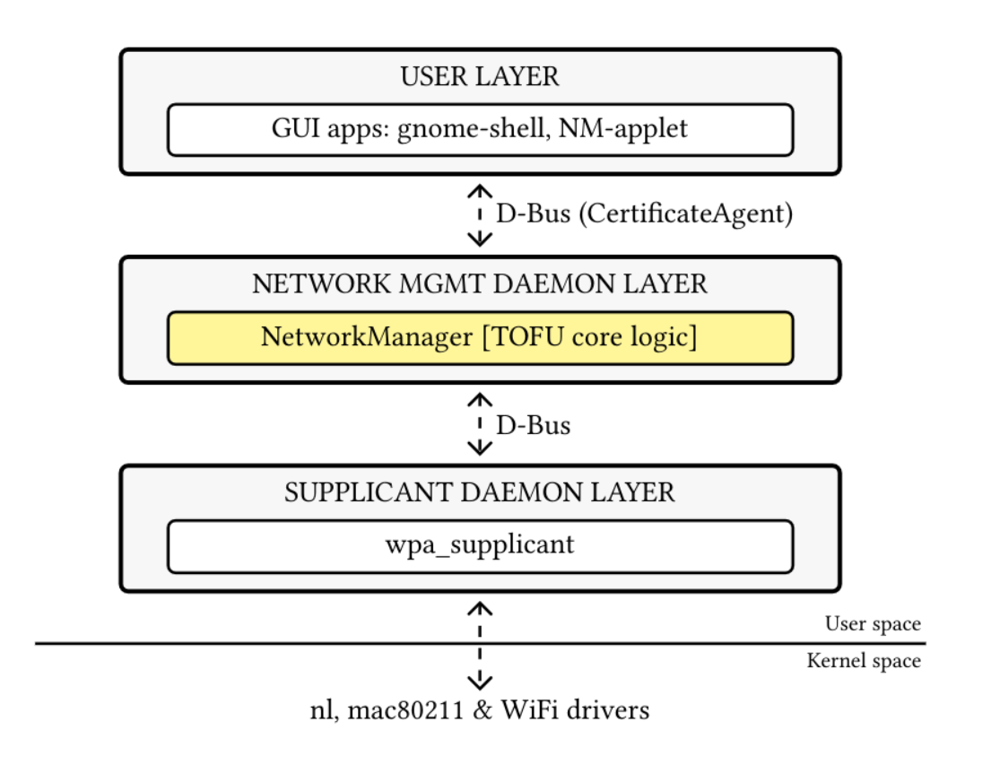

<!-- SPDX-License-Identifier: LGPL-2.1-or-later -->

# Trust On First Use for 802.1X Wi-Fi

NetworkManager can use Trust On First Use (TOFU) when a Wi-Fi connection uses
802.1X authentication without a configured CA certificate. On the first
connection, a certificate agent asks the user whether to trust the server
certificate. After acceptance, NetworkManager pins the certificate identity
for subsequent connections.



## Configure a connection

Enable TOFU for an 802.1X connection with `nmcli`:

```sh
nmcli connection modify "My enterprise network" 802-1x.ca-verify-mode tofu
nmcli connection up "My enterprise network"
```

The default `ca-verify-mode` preserves the existing verification behavior.
TOFU applies only when the connection has no configured CA certificate.

## Certificate agents

The NetworkManager daemon requests a user decision through its private
`org.freedesktop.NetworkManager.CertificateAgent` D-Bus interface. The
`nmtui` connection workflow provides a text-based certificate prompt. A
desktop client can provide its own prompt by implementing this interface.

The decision applies to the connection profile. Use a test profile and
verify the certificate details before accepting an unfamiliar server.

## Building and testing

Build NetworkManager using the instructions in
[`CONTRIBUTING.md`](../CONTRIBUTING.md). To test the complete flow, use an
isolated test access point with 802.1X authentication and a test certificate
chain, and connect with a certificate agent running. `mac80211_hwsim` and
`hostapd` can provide a virtual test environment. The repository does not
include an automated harness for changing the host's Wi-Fi modules,
NetworkManager logging, or system trust store.

Do not use production credentials or a production network for testing.
